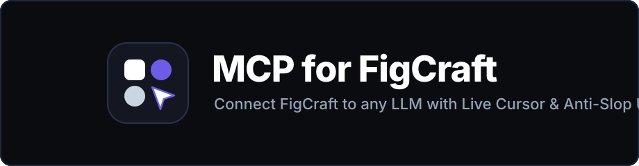
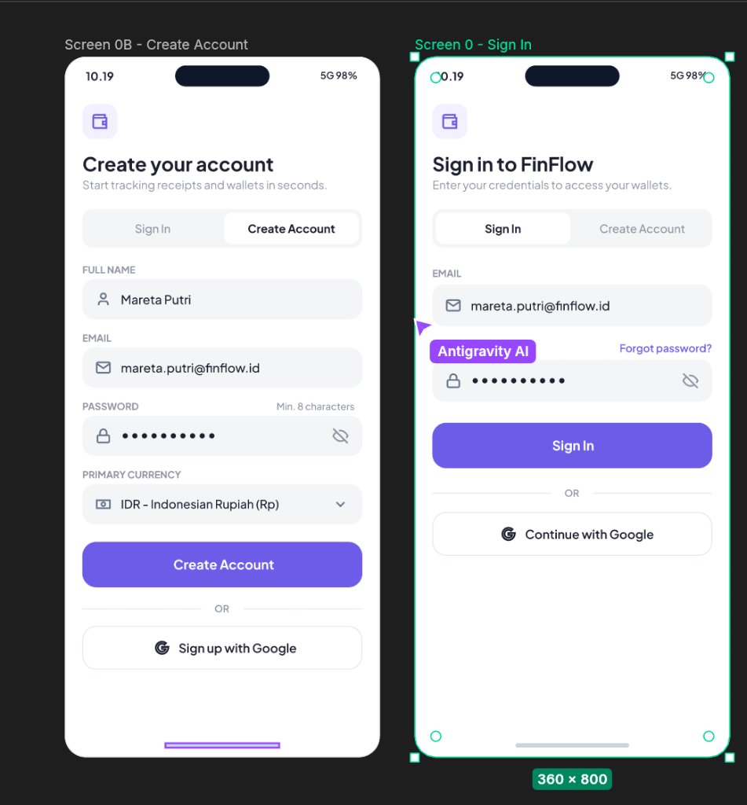
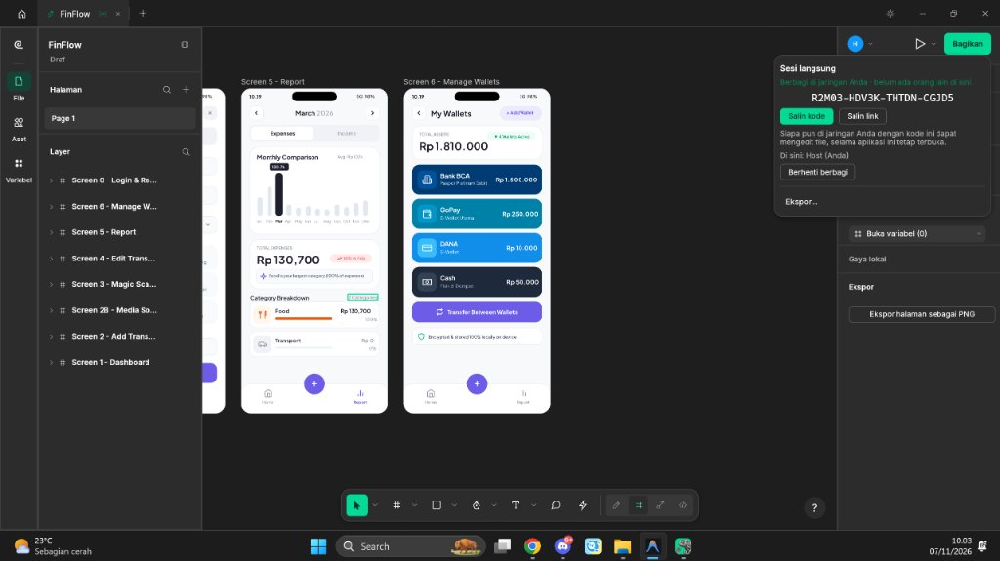
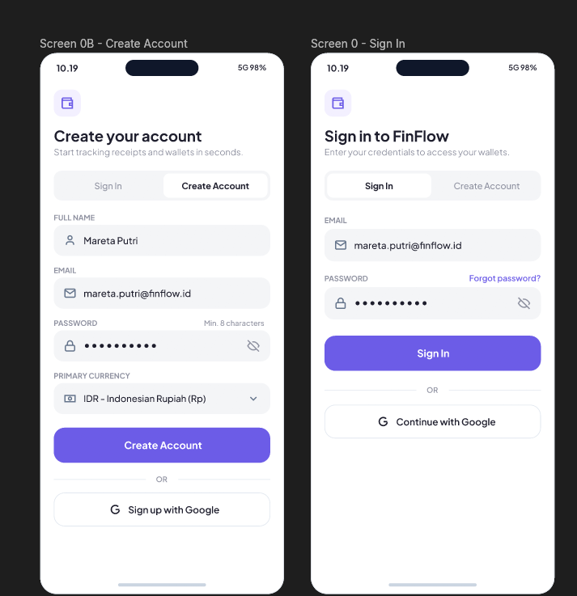
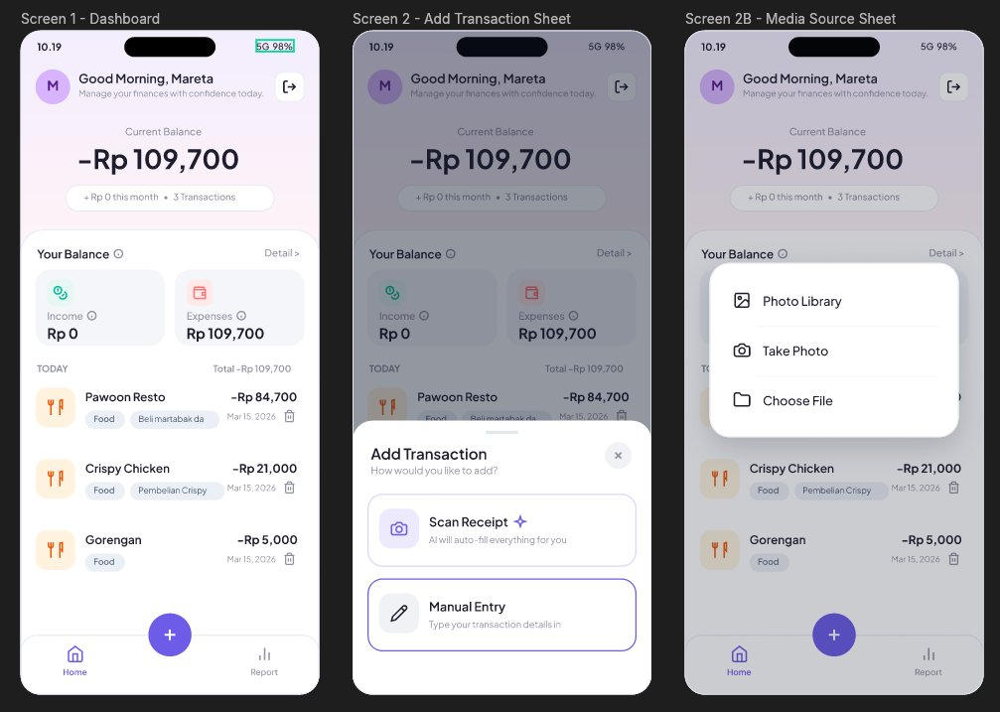
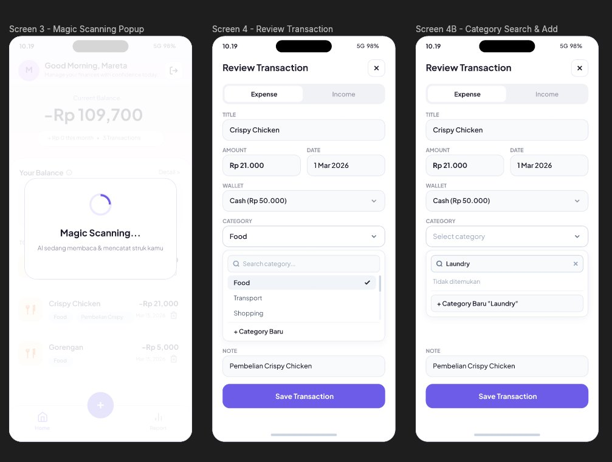
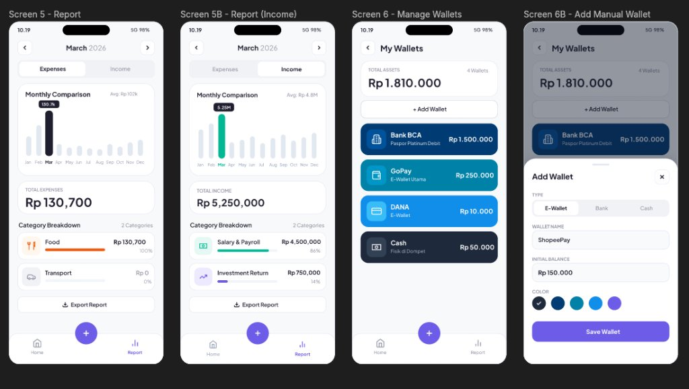
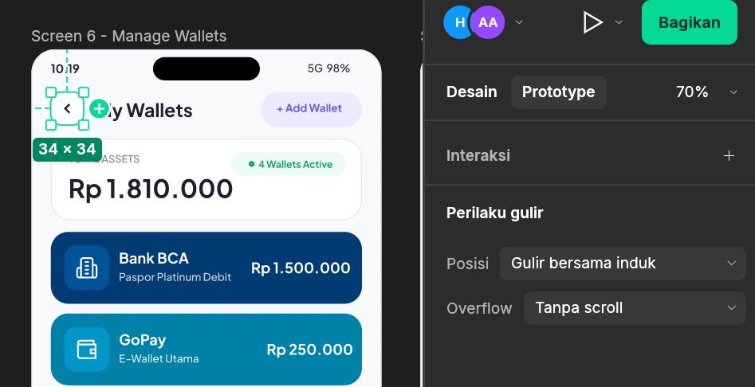

<div align="center">



<h3>Hubungkan AI Coding Agent Anda secara live ke FigCraft Desktop.<br/>Desain, audit, dan buat prototype UI profesional secara real-time.</h3>

<p>
  <a href="https://github.com/zuna107/figcraft-mcp/releases"></a>
  
  
  
  <a href="https://github.com/zuna107/figcraft-mcp/blob/main/LICENSE"></a>
</p>

<p>
  <a href="https://github.com/zuna107/figcraft-mcp/blob/main/README.md">English (README.md)</a> · <b>Bahasa Indonesia</b> · <a href="https://github.com/zuna107/figcraft-mcp/releases">Releases</a> · <a href="https://github.com/zuna107/figcraft-mcp/blob/main/CONTRIBUTING.md">Contributing</a>
</p>

<p><b>Disclaimer:</b> Proyek ini adalah integrasi komunitas berbasis Model Context Protocol (MCP) untuk FigCraft Desktop.</p>

</div>

Berikan akses langsung secara *real-time* kepada **Google Antigravity**, **Cursor**, **Claude Code**, **Claude Desktop**, **Windsurf**, dan AI coding agent lainnya untuk mengendalikan kanvas **FigCraft Desktop** Anda melalui server [Model Context Protocol](https://modelcontextprotocol.io/) ini.

Berbeda dari *bridge* CLI biasa yang menampilkan hasil desain secara kaku sekaligus atau menghasilkan tampilan klise (*AI slop*), **FigCraft-MCP** mengeksekusi setiap komponen secara bertahap dengan pergerakan kursor multiplayer langsung (`~40ms/elemen`) serta menerapkan standar desain **Anti-Slop UI** setara **Shadcn UI**, **Radix Primitives**, dan **Apple HIG**.

[**Lihat panduan instalasi cepat ->**](#instalasi-cepat-quickstart)

---

## Galeri Visual & Demo

### 1. Kursor Multiplayer Real-Time & Live Streaming Bertahap
Setiap elemen (`frame`, `rectangle`, `text`, `vector icon`) dibuat secara bertahap dan cepat (`40ms/elemen`) disertai pergerakan kursor multiplayer (`Antigravity AI`) dan *highlight* seleksi langsung di atas kanvas FigCraft Anda:

<p align="center">
  
  
</p>

### 2. Output Desain Bersih & Bebas AI Slop (Standar Shadcn / Radix / Apple HIG)
Aturan **`anti-slop-ui`** bawaan mencegah model AI membuat gradien neon, badge dekoratif berlebihan (`"Hasil Scan Struk AI"`, `"AI Matched"`), kotak input berwarna mencolok, maupun emoji Unicode:

<p align="center">
  
  
</p>

<p align="center">
  
  
</p>

### 3. Alur Prototype Interaktif
Hubungkan tombol, tab switcher, popup bottom sheet, dan navigasi bawah di seluruh layar dengan animasi `smartAnimate`, `dissolve`, `push`, `slideIn`, dan `moveOut` menggunakan `create_prototype_link`:

<p align="center">
  
</p>

---

## Instalasi Cepat (Quickstart)

**Satu perintah** untuk menyiapkan aplikasi AI Anda (Google Antigravity, Claude Desktop, Claude Code, Cursor, Windsurf, VS Code) dan menghubungkannya ke FigCraft Desktop:

### Windows (PowerShell)

```powershell
irm https://raw.githubusercontent.com/zuna107/figcraft-mcp/main/install.ps1 | iex
```

Dari Command Prompt (CMD): `powershell -c "irm https://raw.githubusercontent.com/zuna107/figcraft-mcp/main/install.ps1 | iex"`

### macOS / Linux

```bash
curl -LsSf https://raw.githubusercontent.com/zuna107/figcraft-mcp/main/install.sh | sh
```

Jika Anda memilih instalasi melalui Git clone lokal atau `uvx`:

```powershell
git clone https://github.com/zuna107/figcraft-mcp.git
cd figcraft-mcp
pip install -e .
figcraft-mcp setup
```

Atau jalankan langsung via `uvx` tanpa clone manual:

```bash
uvx --from git+https://github.com/zuna107/figcraft-mcp figcraft-mcp setup
```

Perintah `figcraft-mcp setup` otomatis mendeteksi aplikasi AI yang terpasang di komputer Anda (**Google Antigravity**, **Claude Desktop**, **Claude Code**, **Cursor**, **Windsurf**, **VS Code**), menambahkan konfigurasi server `figcraft`, dan menyimpan cadangan file lama dengan akhiran `.bak`.

Setelah selesai, **tutup dan buka kembali aplikasi AI / IDE Anda**, buka **FigCraft Desktop**, lalu minta AI untuk membuat, mengaudit, atau menghubungkan prototype desain UI.

<details>
<summary><b>Konfigurasi manual (jika setup otomatis tidak digunakan)</b></summary>

### 1. Tambahkan ke `mcp_config.json` / `claude_desktop_config.json` / `.cursor/mcp.json`

```json
{
  "mcpServers": {
    "figcraft": {
      "command": "figcraft-mcp",
      "args": [],
      "env": {
        "FIGCRAFT_PORT": "7979",
        "FIGCRAFT_STREAM_STEPS": "1",
        "FIGCRAFT_STREAM_DELAY_MS": "40"
      }
    }
  }
}
```

Atau jalankan tanpa instalasi menggunakan **Node.js (`npx`)**:

```json
{
  "mcpServers": {
    "figcraft": {
      "command": "npx",
      "args": ["-y", "github:zuna107/figcraft-mcp"],
      "env": {
        "FIGCRAFT_PORT": "7979",
        "FIGCRAFT_STREAM_STEPS": "1",
        "FIGCRAFT_STREAM_DELAY_MS": "40"
      }
    }
  }
}
```

### 2. Pasang sebagai Plugin Lengkap (MCP + Skills + Rules)

Agar server MCP aktif bersama skill **`figcraft`**, skill **`anti-slop-ui`**, dan aturan **`rules/AGENTS.md`**:

```powershell
# Google Antigravity (Global Plugin)
git clone https://github.com/zuna107/figcraft-mcp.git "$HOME\.gemini\config\plugins\figcraft-mcp"

# Plugin Khusus Workspace Proyek
git clone https://github.com/zuna107/figcraft-mcp.git ".agents\plugins\figcraft-mcp"
```

</details>

---

## Cara Penggunaan dengan FigCraft Desktop

1. **Koneksi Otomatis ke Aplikasi Desktop (`--control 7979`)**:
   - Saat AI Agent memanggil tool `figcraft`, server memeriksa port TCP `7979`. Jika FigCraft Desktop belum terbuka, aplikasi akan dijalankan otomatis dengan mode `--control 7979`.
2. **Mendukung Mode Sesi Langsung (`Bagikan -> Sesi langsung`)**:
   - Apabila Anda sedang membuka ruang kolaborasi langsung, `figcraft-mcp` otomatis mendeteksi dokumen dengan status `live` melalui `doc.list` dan `collab.peers` sehingga seluruh perubahan langsung tampil di layar Anda.
3. **Contoh Perintah (Prompt) ke AI Agent**:
   - *"Buat Screen Sign In dan Create Account berdampingan menggunakan panduan anti-slop-ui dengan tab switcher netral."*
   - *"Ubah bagian Category pada Screen 4 menjadi menu dropdown ringkas yang memiliki kolom search, scrollbar vertikal di dalamnya, dan opsi `+ Category Baru` ketika kategori tidak ditemukan."*
   - *"Audit Screen 5 dan Screen 6 agar warnanya netral, hapus badge AI yang terlalu ramai, dan letakkan tombol `+ Add Wallet` tepat di bawah kartu Total Assets."*
   - *"Buat koneksi prototype flow untuk seluruh layar di Page 1."*

---

## Daftar Tool MCP (Total 25 Tool)

Selain meneruskan 22 tool bawaan `figcraft-cli` (`inspect_document`, `get_node`, `create_node`, `set_properties`, `batch`, `run_command`, `export`, `screenshot`, `save_file`, dll.), `figcraft-mcp` menyediakan **3 tool tingkat tinggi**:

| Nama Tool | Fungsi |
| :--- | :--- |
| `get_anti_slop_guidelines` | Mengambil sistem token warna netral (`#FFFFFF`, `#F8FAFC`, `#F1F5F9`, `#E2E8F0`), skala tipografi (`Plus Jakarta Sans`), daftar pola AI slop yang dilarang, dan resep komponen. |
| `place_lucide_icon` | Menempatkan **39 ikon garis vektor Lucide 24x24** (`search`, `download`, `wallet`, `home`, `barChart`, `plus`, `x`, `check`, `chevronDown`, `user`, `mail`, `lock`, dll.) secara presisi dalam 1 langkah. |
| `create_prototype_link` | Menghubungkan elemen pemicu (`sourceId`) ke frame tujuan (`targetFrameId`) dengan animasi `smartAnimate`, `dissolve`, `push`, `slideIn`, atau `moveOut`. |

---

## Perbandingan Sebelum vs Sesudah Anti-Slop UI

| Komponen | Pola AI Slop (Dilarang) | Standar FigCraft-MCP (Diterapkan) |
| :--- | :--- | :--- |
| **Header & Kartu Ringkasan** | Penuh badge ungu/merah muda (`✨ Hasil Scan Struk AI`, `📈 18% vs Feb`, `✨ Food is your largest category`) | Bersih & fokus pada hierarki tipografi (`#1E1E2D` Bold & `#8F92A1` Muted) tanpa dekorasi berlebihan |
| **Segmented Tab Switcher** | Berisi ikon panah warna merah/hijau di dalam tab | Track netral `#F1F2F6`, pill aktif `#FFFFFF`, teks rata tengah tanpa ikon |
| **Menu Dropdown Kategori** | Trigger oranye terang (`#FFF7ED`), pill `"AI Matched"`, daftar memanjang tanpa batas | Menu ringkas `180px` `#FFFFFF`, border `#CBD5E1`, baris aktif `#F1F5F9`, scrollbar vertikal `4px`, dan baris `+ Category Baru` |
| **Ikonografi** | Emoji Unicode (`🍔`, `🚗`, `💰`, `✨`) | 100% ikon garis vektor **Lucide 24x24** melalui `place_lucide_icon` |
| **Popup & Bottom Sheet** | Melayang di atas kotak hitam kosong | Menduplikasi layar induk sebagai *locked backdrop* di belakang *scrim* `#0F172A` (`45%` opacity) |

---

## Kontribusi & Komunitas

Kontribusi penambahan ikon vektor, resep komponen Anti-Slop UI, dan dukungan klien baru sangat terbuka!
- Baca [Panduan Kontribusi (CONTRIBUTING.md)](./CONTRIBUTING.md) untuk memulai pengembangan lokal dan menjalankan pengujian unit.
- Lihat [Roadmap](./ROADMAP.md), [Changelog](./CHANGELOG.md), dan [Kebijakan Keamanan (SECURITY.md)](./SECURITY.md).

---

## Lisensi

Dirilis di bawah lisensi [MIT License](./LICENSE).
