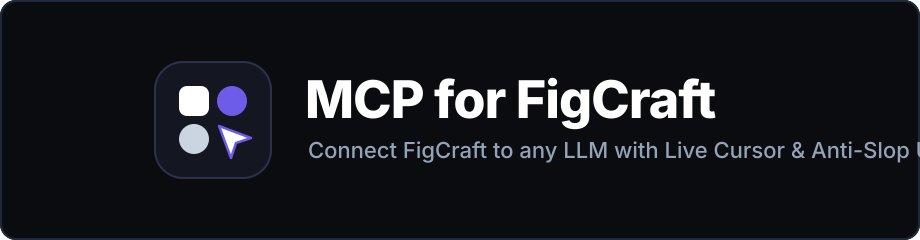
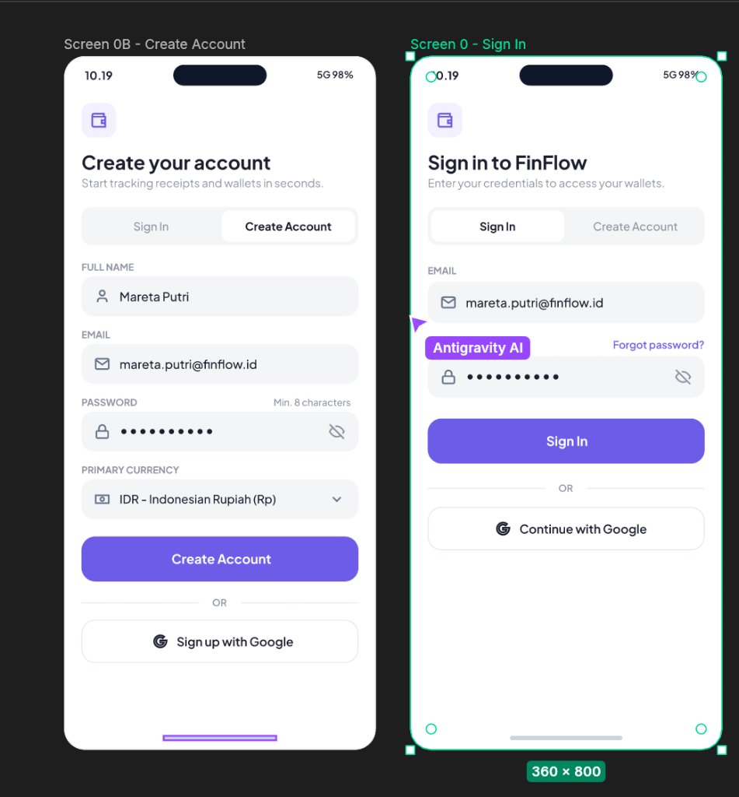
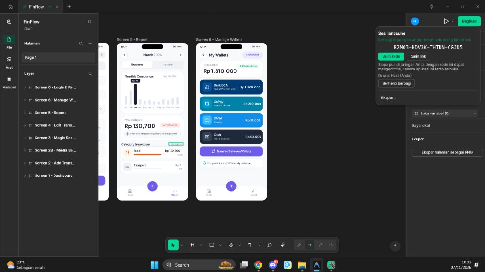
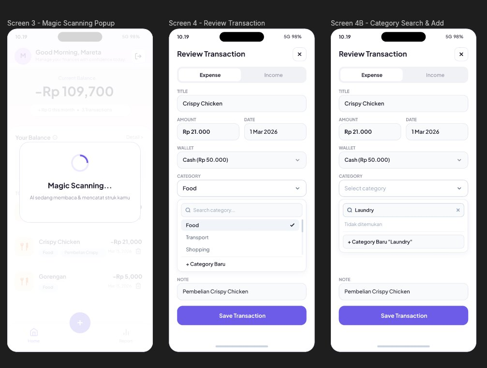
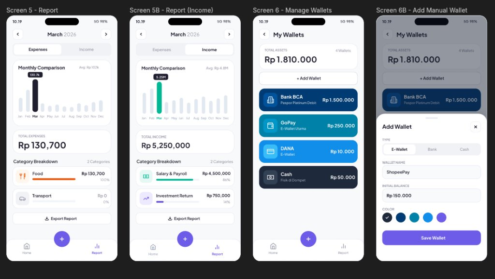
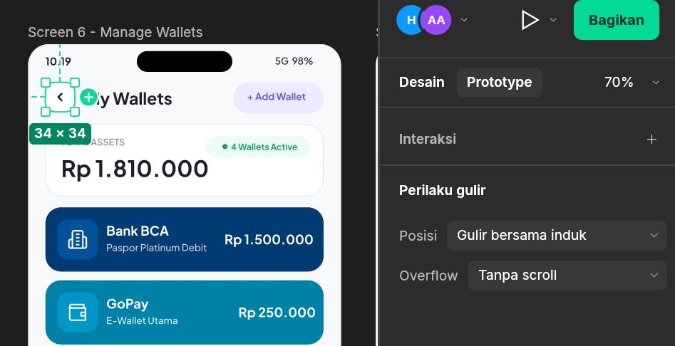

<div align="center">



<h3>Give your AI coding agent live access to FigCraft Desktop.<br/>Design, audit, and prototype clean UI screens in real time.</h3>

<p>
  <a href="https://github.com/zuna107/figcraft-mcp/releases"></a>
  
  
  
  <a href="https://github.com/zuna107/figcraft-mcp/blob/main/LICENSE"></a>
</p>

<p>
  <b>English</b> · <a href="https://github.com/zuna107/figcraft-mcp/blob/main/README.id.md">Bahasa Indonesia (README.id.md)</a> · <a href="https://github.com/zuna107/figcraft-mcp/releases">Releases</a> · <a href="https://github.com/zuna107/figcraft-mcp/blob/main/CONTRIBUTING.md">Contributing</a>
</p>

<p><b>Disclaimer:</b> This is a community-built Model Context Protocol (MCP) integration for FigCraft Desktop.</p>

</div>

Give **Google Antigravity**, **Cursor**, **Claude Code**, **Claude Desktop**, **Windsurf**, and other AI-powered coding tools live, real-time control over your **FigCraft Desktop** canvas with this [Model Context Protocol](https://modelcontextprotocol.io/) server.

Unlike static CLI bridges that dump layouts in a single frozen frame or generate noisy "AI slop" interfaces, **FigCraft-MCP** streams every element step-by-step with a live multiplayer cursor (`~40ms/element`) and enforces a strict **Anti-Slop UI** design system inspired by **Shadcn UI**, **Radix Primitives**, and **Apple HIG**.

[**See quickstart instructions ->**](#quickstart) · [**See step-by-step usage guide ->**](#how-to-use-with-figcraft-desktop)

---

## Visual Showcase & Demo

### 1. Real-Time Multiplayer Cursor & Step-by-Step Live Streaming
Every layer (`frame`, `rectangle`, `text`, `vector icon`) is created step-by-step at `40ms/element` with live multiplayer cursor tracking (`Antigravity AI`) and bounding-box selection highlights on your open FigCraft canvas:

<p align="center">
  
  
</p>

### 2. Clean, Anti-Slop UI Output (Shadcn / Radix / Apple HIG Standard)
Built-in **`anti-slop-ui`** rules prevent AI models from generating neon gradients, gratuitous `"AI Insight"` or `"AI Matched"` sparkle badges, loud orange/purple input boxes, or Unicode emojis:

<p align="center">
  
  
</p>

### 3. Interactive Prototype Flows
Connect buttons, segmented tabs, popup bottom sheets, and navigation bars across all frames with `smartAnimate`, `dissolve`, `push`, `slideIn`, and `moveOut` transitions using `create_prototype_link`:

<p align="center">
  
</p>

---

## Quickstart

**One command** sets up your AI apps (Google Antigravity, Claude Desktop, Claude Code, Cursor, Windsurf, VS Code) and links them to FigCraft Desktop:

### macOS / Linux

```bash
curl -LsSf https://raw.githubusercontent.com/zuna107/figcraft-mcp/main/install.sh | sh
```

### Windows (PowerShell)

```powershell
irm https://raw.githubusercontent.com/zuna107/figcraft-mcp/main/install.ps1 | iex
```

From Command Prompt instead: `powershell -c "irm https://raw.githubusercontent.com/zuna107/figcraft-mcp/main/install.ps1 | iex"`

Prefer not to run a remote script? Clone the repository or use `uvx` directly:

```powershell
git clone https://github.com/zuna107/figcraft-mcp.git
cd figcraft-mcp
pip install -e .
figcraft-mcp setup
```

Already have `uv` installed? Run `setup` directly from GitHub:

```bash
uvx --from git+https://github.com/zuna107/figcraft-mcp figcraft-mcp setup
```

`figcraft-mcp setup` automatically locates the MCP clients installed on your machine (**Google Antigravity**, **Claude Desktop**, **Claude Code**, **Cursor**, **Windsurf**, **VS Code**), adds the `figcraft` server entry, and saves a `.bak` backup of each config file it modifies.

Then **fully quit and reopen your AI app**, open **FigCraft Desktop**, and ask your AI agent to design, audit, or prototype screens.

<details>
<summary><b>Manual setup, in case the automatic setup doesn't work</b></summary>

### 1. Add to `mcp_config.json` / `claude_desktop_config.json` / `.cursor/mcp.json`

```json
{
  "mcpServers": {
    "figcraft": {
      "command": "figcraft-mcp",
      "args": [],
      "env": {
        "FIGCRAFT_PORT": "7979",
        "FIGCRAFT_STREAM_STEPS": "1",
        "FIGCRAFT_STREAM_DELAY_MS": "40"
      }
    }
  }
}
```

Or run zero-install via **Node.js (`npx`)**:

```json
{
  "mcpServers": {
    "figcraft": {
      "command": "npx",
      "args": ["-y", "github:zuna107/figcraft-mcp"],
      "env": {
        "FIGCRAFT_PORT": "7979",
        "FIGCRAFT_STREAM_STEPS": "1",
        "FIGCRAFT_STREAM_DELAY_MS": "40"
      }
    }
  }
}
```

Or run zero-install via **`uvx`**:

```json
{
  "mcpServers": {
    "figcraft": {
      "command": "uvx",
      "args": ["--from", "git+https://github.com/zuna107/figcraft-mcp", "figcraft-mcp"],
      "env": {
        "FIGCRAFT_PORT": "7979",
        "FIGCRAFT_STREAM_STEPS": "1",
        "FIGCRAFT_STREAM_DELAY_MS": "40"
      }
    }
  }
}
```

### 2. Install as a Full Agent Plugin (MCP + Skills + Rules)

To bundle the MCP server together with the **`figcraft`** skill, **`anti-slop-ui`** skill, and always-on **`rules/AGENTS.md`**:

```bash
# Google Antigravity (Global Plugin)
git clone https://github.com/zuna107/figcraft-mcp.git ~/.gemini/config/plugins/figcraft-mcp

# Workspace-Scoped Plugin
git clone https://github.com/zuna107/figcraft-mcp.git .agents/plugins/figcraft-mcp
```

</details>

---

## How to Use with FigCraft Desktop

Follow these step-by-step instructions to design, inspect, audit, and prototype UI screens live in FigCraft Desktop:

### Step 1: Launch FigCraft Desktop & Configure Preferences (Optional)
1. You do **not** need to pass any special command-line flags manually. When your AI agent calls any `figcraft` MCP tool, `figcraft-mcp` checks TCP port `7979` and automatically launches the visible **FigCraft Desktop** window with `--control 7979` if it is not running yet.
2. If you launch FigCraft Desktop yourself from a terminal or shortcut, include `--control 7979`:
   ```powershell
   "C:\Program Files\ArtCraft\FigCraft\figcraft.exe" --control 7979
   ```
3. **Switching Interface Language:** Press `Ctrl + ,` (or click the top-left menu icon -> `Edit` -> `Preferences` -> `Interface Language`) to switch the FigCraft Desktop UI language (e.g., `English`), or ask your AI agent to run `pref.language` with `{"language": "en"}`.

### Step 2: Connect Your Canvas (Choose Mode A or Mode B)

#### Mode A: Zero-Click Local Control (Default)
- Simply open any `.figcraft` file (or start a new tab) in FigCraft Desktop and send a prompt in your AI IDE.
- `figcraft-mcp` automatically locks onto your active document and streams every `frame`, `rectangle`, `text`, and `vector icon` step-by-step (`~40ms/element`) with live bounding-box selection highlights.

#### Mode B: Live Collaboration Session & Multiplayer AI Cursor (`Share -> Live Session`)
- Want to see the purple **`Antigravity AI`** multiplayer cursor move across your canvas in real time?
  1. In the top-right corner of FigCraft Desktop, click **`Share`** -> **`Live Session`** (or ask your AI agent to start a local live session via `collab.share` with `{"via": "local"}`).
  2. `figcraft-mcp` automatically inspects `doc.list` and `collab.peers` to attach to the active `live` session tab and broadcasts real-time cursor coordinates (`collab.cursor`) as it builds and edits components on your canvas.

### Step 3: Prompt Your AI Agent (Step-by-Step Workflow)

You can talk to your AI agent in natural language. Here is the recommended workflow:

1. **Generate Clean UI Screens from Requirements (Anti-Slop UI Enabled)**
   > *"Create Sign In and Create Account screens side-by-side (360x800) following the anti-slop-ui guidelines with a clean neutral segmented tab switcher and Lucide vector icons."*
2. **Build Interactive Overlays & Searchable Components**
   > *"Create Popup Bottom Sheets for Screen 2 and Screen 3 using Screen 1 as a locked backdrop behind a 45% dark scrim."*
   > *"Update Screen 4 to use a compact searchable category dropdown (max 180px height) with an internal 4px vertical scrollbar and a `+ New Category` option when a search query is not found."*
3. **Audit & Refactor Existing Screens to Remove AI Slop**
   > *"Audit Screen 5 and Screen 6 using anti-slop-ui rules: remove decorative AI sparkle badges, keep colors neutral, and place the `+ Add Wallet` button directly below the Total Assets card."*
4. **Wire & Test Interactive Prototype Flows**
   > *"Connect all screens on Page 1 with interactive prototype transitions (`smartAnimate` for tabs, `slideIn` for bottom sheets, `push` for screen navigation)."*
   - To test the interactive flow in FigCraft Desktop, switch the right sidebar to the **`Prototype`** tab or click the **Play (`▶`)** button in the top-right toolbar.

---

## Available MCP Tools (25 Total)

In addition to forwarding all 22 native FigCraft CLI tools (`inspect_document`, `get_node`, `create_node`, `set_properties`, `batch`, `run_command`, `export`, `screenshot`, `save_file`, `open_file`, `pointer`, `key`, `type_text`, `select`, `undo`, `redo`, etc.), `figcraft-mcp` injects **3 specialized tools**:

| Tool Name | Description |
| :--- | :--- |
| `get_anti_slop_guidelines` | Returns the neutral color tokens (`#FFFFFF`, `#F8FAFC`, `#F1F5F9`, `#E2E8F0`), typography scale (`Plus Jakarta Sans`), banned AI clichés, and component recipes. |
| `place_lucide_icon` | Places any of **39 pre-scaled 24x24 Lucide vector icons** (`search`, `download`, `wallet`, `home`, `barChart`, `plus`, `x`, `check`, `chevronDown`, `user`, `mail`, `lock`, etc.) with 0 extra RPC round-trips. |
| `create_prototype_link` | Connects a clickable source node (`sourceId`) to a target screen frame (`targetFrameId`) with `smartAnimate`, `dissolve`, `push`, `slideIn`, or `moveOut` transitions. |

---

## Anti-Slop UI Design Standards

Every agent using `figcraft-mcp` is guided by the bundled [`anti-slop-ui`](./skills/anti-slop-ui/SKILL.md) skill and [`rules/AGENTS.md`](./rules/AGENTS.md):

| Component | AI Slop Pattern (Banned) | FigCraft-MCP Standard (Enforced) |
| :--- | :--- | :--- |
| **Headers & Summary Cards** | Gratuitous purple/pink badges (`✨ AI Receipt Scan Result`, `📈 18% vs Feb`, `✨ Food is your largest category`) | Clean typographic hierarchy (`#1E1E2D` Bold & `#8F92A1` Muted) with zero decorative clutter |
| **Segmented Tab Switchers** | Colored red/green arrows or icons inside tabs | Neutral `#F1F2F6` track, `#FFFFFF` active pill, centered text only (`#1E1E2D` / `#8F92A1`) |
| **Category Dropdowns** | Bright orange/purple fills (`#FFF7ED`), `"AI Matched"` pills, unscrollable tall lists | Compact `180px` `#FFFFFF` menu, `#CBD5E1` border, `#F1F5F9` active row, `4px` vertical scrollbar, and clean `+ New Category` action |
| **Iconography** | Inconsistent Unicode emojis (`🍔`, `🚗`, `💰`, `✨`) | 100% crisp 24x24 **Lucide vector stroke icons** via `place_lucide_icon` |
| **Popups & Bottom Sheets** | Floating sheet over an empty black box | Parent screen duplicated as a locked backdrop behind a `45%` `#0F172A` scrim |

---

## Environment Variables

| Variable | Default | Description |
| :--- | :--- | :--- |
| `FIGCRAFT_PORT` | `7979` | TCP control port used to attach to the live FigCraft Desktop instance. |
| `FIGCRAFT_STREAM_STEPS` | `1` | `1` streams `batch` commands step-by-step with live cursor movement; `0` executes instantly. |
| `FIGCRAFT_STREAM_DELAY_MS` | `40` | Delay in milliseconds between streamed elements (`40ms` = 25 elements/sec). |
| `FIGCRAFT_DEFAULT_DOC` | *(empty)* | Optional `.figcraft` file path to auto-open when launching FigCraft Desktop. |
| `FIGCRAFT_CLI_PATH` | *(auto)* | Custom path to `figcraft-cli` executable. |
| `FIGCRAFT_APP_PATH` | *(auto)* | Custom path to `figcraft` desktop executable. |

---

## Contributing & Community

Contributions, icon additions, and Anti-Slop UI component recipes are welcome!
- Read the [Contributing Guide](./CONTRIBUTING.md) to get started with local development and unit testing.
- Review the [Roadmap](./ROADMAP.md) and [Changelog](./CHANGELOG.md).
- For security reports, see our [Security Policy](./SECURITY.md).

---

## License

Released under the [MIT License](./LICENSE).
